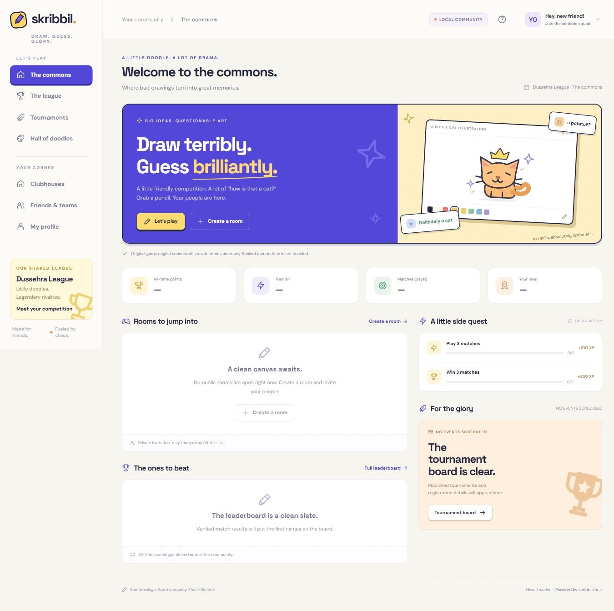
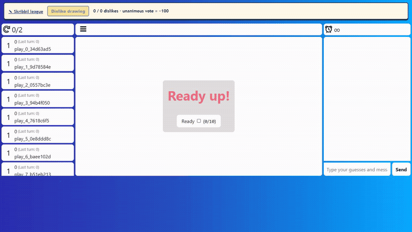
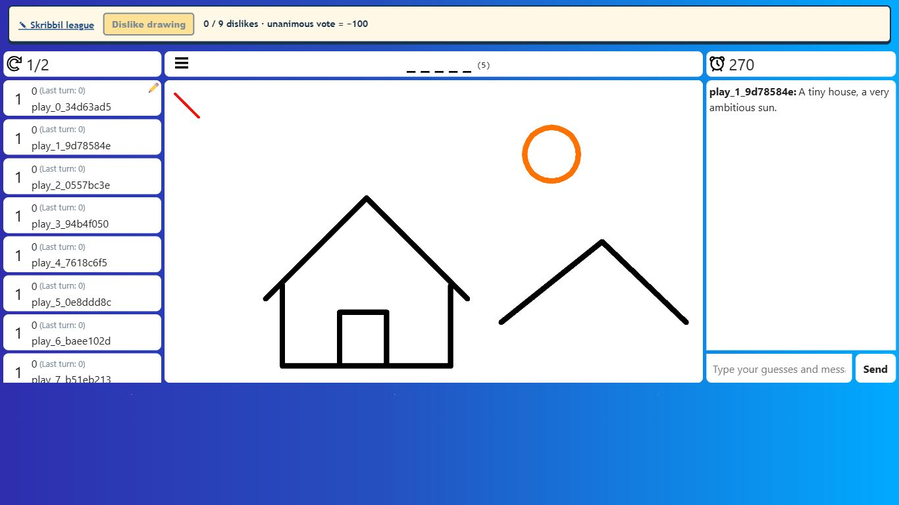
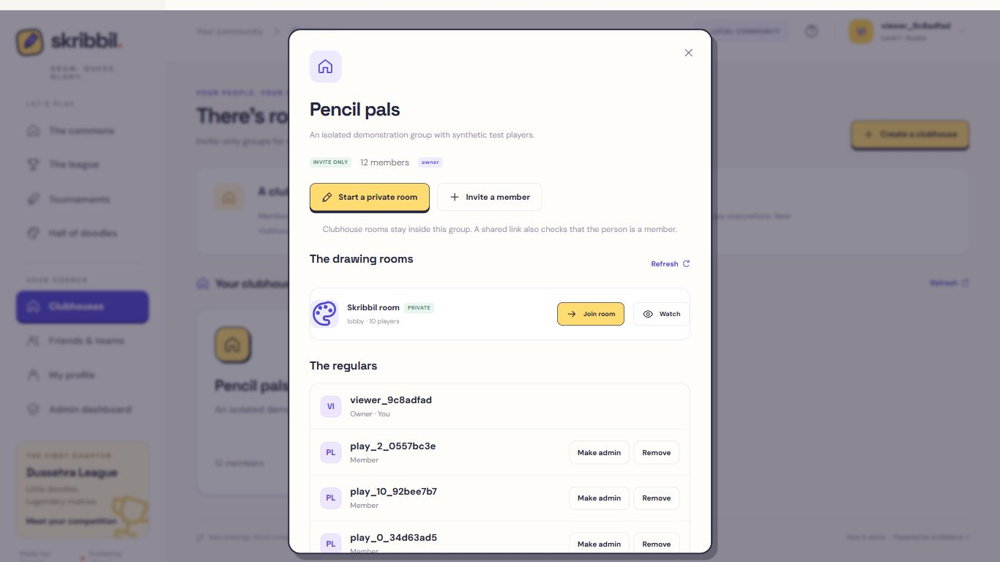
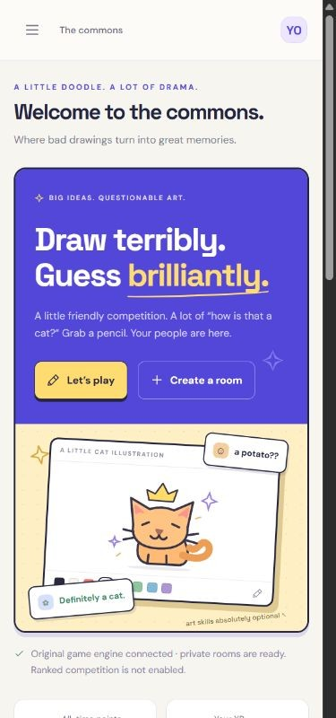
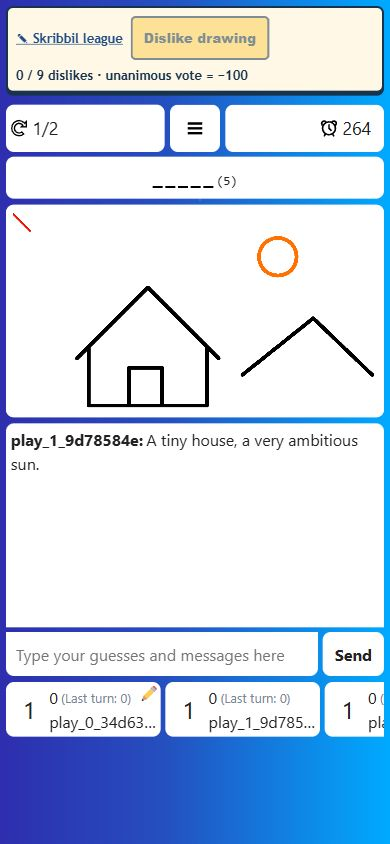

# Skribbil

### Draw terribly. Guess brilliantly.

**Dussehra League of Skribbil** brings profiles, private friend groups, clans,
tournaments, and a shared league around the original
[scribble.rs](https://github.com/scribble-rs/scribble.rs) drawing game.
The familiar canvas, guesses, rounds, and real-time rooms still run on its Go
engine. The community around them is new.

**[Play Skribbil →](https://skribbil.pages.dev)**

**Live casual preview · Free hosting · Ranked disabled**

Register at the live site and create a private room. The free backend may need
about a minute to wake after inactivity.



*The commons, captured from the running local app. Rooms, rankings, artwork,
and progress come from real community activity; new communities start empty.*

[Run locally](#run-locally) · [Find your people](#find-your-people) ·
[Watch the demo](#the-original-game-with-a-community-around-it) ·
[Architecture](docs/architecture.md) · [Feature status](docs/feature-status.md)

## The original game, with a community around it

Pick a word. Draw something questionable. Watch your friends guess everything
except the answer. Skribbil keeps that experience inside the original Go engine,
with a small league extension for identity, results, and the dislike penalty.

[](https://github.com/Kenshi0905/skribbil/raw/refs/heads/main/docs/media/gameplay.mp4)

**[Download the silent gameplay video →](https://github.com/Kenshi0905/skribbil/raw/refs/heads/main/docs/media/gameplay.mp4)**
The GIF plays here; download the MP4 for a larger, silent clip. GitHub does not
provide an inline player for repository MP4 files.

<details>
<summary>See the desktop game screen</summary>



</details>

The screenshots and animation are edited screen captures from an **automated
local test with synthetic accounts**. They show the running application, not
human matches or captures of the deployed service. [Capture notes and evidence](docs/media/README.md).

## Find your people

| Place | What it is |
| --- | --- |
| **The commons** | The shared home: discover rooms, check progress, and find the next event. |
| **Clubhouses** | Invite-only friend groups. A platform admin creates one or approves a player's request. Members can start, join, and watch private rooms together. |
| **Clans / teams** | Competitive teams with a name, tag, logo, captain, and roster for team tournaments. A clan is separate from a Clubhouse. |
| **The league** | Shared competition infrastructure: seasons, historical results, tournaments, and all-time records. |



*A synthetic demonstration Clubhouse. Even with a room link, playing or spectating
requires current membership. Platform admins who are not members cannot join.*

Your account, friends, cosmetics, teams, and league identity belong to the
community. **Skribbil is the only playable game today**; the schema and adapter
boundary let future games share that identity and league.

## A smaller screen, the same canvas

<p align="center">
  
  &nbsp;&nbsp;
  
</p>

*Narrow browser captures. The sidebar scrolls, forms fit the viewport, and the
game provides larger controls and pointer input. These are viewport checks,
not physical-phone photographs or proof of real-device touch behavior.*

## What you can do

- **Make it yours:** profiles, uploaded avatars, owned titles and frames, match
  history, XP, daily/weekly challenges, achievements, and trophies.
  In **Your profile → Avatar**, build a character from preset hair, eyes, brows,
  mouths, accessories, and colors, or upload your own PNG/JPG photo. Preview,
  randomize, and reset your character before saving. Save your
  look to use it across the account menu, friends list, and leaderboards.
- **Set the mood:** quieter pop effects, saved sound volume, and a one-click mute.
- **Play together:** configurable private rooms, spectators, friends, parties,
  Clubhouse invitations, team rosters, and a shared quick-rematch room.
- **Run a competition:** individual/team registration, brackets, seasons,
  standings, and audited tools for fixture results, disputes, and score corrections.
- **Keep the good doodles:** automatic archives, artist-controlled publication
  consent, curated Halls of Fame and Shame, MVP votes, and match summary cards.

Tournament fixture results are currently entered by an admin. Replay downloads
contain final canonical drawing operations, not timed stroke-by-stroke playback.
See the [complete feature and limitation table](docs/feature-status.md).

### The unanimous dislike penalty

Each eligible player can dislike a drawing once. When **every player in the
turn's frozen voting group** votes, the artist immediately loses exactly
**100 points**, once, and faces a harder word on their next drawing turn.
The artist and spectators do not vote; disconnecting never lowers the threshold.

Go applies this under its existing room lock. All offered choices and the timeout
choice use the hard pool, and the platform carries pending account-bound penalties
across matches. [Implementation and delivery limits](docs/engine-integration.md).

## Run locally

Requires **Node.js 22+** (24 recommended), **npm**, and **Go 1.25+**.
No hosted account or API key is needed.

**macOS / Linux**

```sh
npm ci
mkdir -p .tools
cd engine
go build -o ../.tools/skribbil-engine ./cmd/scribblers
cd ..
npm run dev
```

**Windows PowerShell**

```powershell
npm ci
New-Item -ItemType Directory -Force .tools
Set-Location engine
go build -o ../.tools/skribbil-engine.exe ./cmd/scribblers
Set-Location ..
npm run dev
```

Open [Skribbil locally](http://localhost:3000), register, and create a private room.
The launcher starts both services. `PORT` and `ENGINE_PORT` change their defaults,
3000 and 4181. `npm start` runs only the platform; set `ENGINE_URL` if Go runs separately.

Embedded PostgreSQL persists in `.data/postgres`, private artwork in
`.data/assets`, and generated development secrets inside `.data/`. These paths
are Git-ignored. Accounts and results use the database, not browser-only demo state.

### Account settings and local administration

Use the account menu → **Account settings** to edit your profile or change your
password. Changes verify the current password, sign out other sessions, and keep
the requesting browser signed in with a new session.

To grant your registered account local admin access, **stop the dev server first**:

```sh
npm run admin -- YOUR_REGISTERED_USERNAME
npm run dev
```

Replace the placeholder with your username. The embedded database allows one
process at a time. Admins approve Clubhouse requests, manage competitions, review
disputes, curate consented artwork, and record audited corrections.

Configuration is in [.env.example](.env.example). Keep real passwords, tokens,
personal data, and private assets out of Git. Use ignored local files or the
host's secret environment, and review staged changes before pushing.
Enable the included commit/push guards with
`git config core.hooksPath .githooks`. The push guard inspects all outgoing commits,
including intermediate versions. `npm run check:secrets` adds a repository check; it cannot guarantee that every
possible secret or personal detail will be detected.

## Under the hood

The plain JavaScript/CSS frontend talks to a Node platform for accounts,
membership, progression, and results. The pinned Go engine owns drawing,
guessing, timers, and concurrent rooms. The gateway streams WebSocket traffic
without rewriting game packets; authenticated asynchronous results enter
transactional receipts and ledgers that prevent duplicate awards.

Drawings normally expire after **30 days**, canonical replay data after **7 days**.
Public artwork needs artist consent and admin selection; active curation and
legal holds affect retention. Production uses PostgreSQL for metadata and a
private object store for artwork. Local OMV hosting is deferred.

| Read next | What you'll find |
| --- | --- |
| [Schema](database/schema.sql) · [Data model](docs/data-model.md) | Universal accounts, game modules, social groups, seasons, and drawing metadata. |
| [Architecture and storage](docs/architecture.md) | Service boundaries and OMV versus object storage: privacy, bandwidth, NAT, uptime, and database load. |
| [Engine integration](docs/engine-integration.md) | Preserved Go flow, voting rules, harder words, and delivery guarantees. |
| [Feature status](docs/feature-status.md) · [Verification](docs/verification.md) | Implemented behavior, incomplete features, and launch limitations. |
| [Live deployment](docs/free-deployment.md) | Hosting, production configuration, verified checks, and free-tier limits. |
| [Changelog](CHANGELOG.md) | Major implementation changes. |

## Verification and launch status

Local verification includes **10 real WebSocket player connections plus a
spectator**. Three clients used mobile user-agent strings, which tests protocol
behavior rather than phone input. Browser layouts were inspected at **360, 390,
and 430 CSS pixels**, alongside automated pointer-event tests. Physical phone,
stylus, and on-screen-keyboard testing remain outstanding.

```sh
npm test
npm run check
npm run check:secrets
node --test infra/tests/*.test.mjs
cd engine
go test -race ./...
```

Go's race detector needs a supported C toolchain. On Windows, use suitable
64-bit GCC and `CGO_ENABLED=1`; CI runs race checks on Ubuntu. These checks and
media demonstrate local behavior, not production load capacity.

**The casual preview launched on 13 October 2026 at [skribbil.pages.dev](https://skribbil.pages.dev).**
Cloudflare Pages serves the website; [the Render service](https://skribbil.onrender.com)
runs Node and Go together in Singapore. PostgreSQL and private artwork storage
use Supabase Free in the Skribbil Games organization. All services use Free plans,
with automatic deployment after all four CI checks pass on `main`. GitHub Actions
deploys the tested server revision before publishing the website. Pages backend
bindings exist only in production; preview bindings are empty. The **Dark** toggle
in the top bar remembers your theme, including in game rooms.

The initial launch was verified at [`dab93f4`](https://github.com/Kenshi0905/skribbil/commit/dab93f4),
with all four jobs passing in [CI run 38290967168](https://github.com/Kenshi0905/skribbil/actions/runs/38290967168).
Live site/backend health checks, verified PostgreSQL TLS, and private S3 upload,
signed read, anonymous-read denial, and deletion have passed. Two real administrator
accounts were provisioned privately. No account credentials are published.
Live authentication and WSS checks passed with two players and one spectator in
an unstarted private room, including chat, spectator restrictions, and account
identity enforcement. A separate two-player reconnect check passed with graceful
close acknowledgement, preserved identity, an empty canvas, and zero scores.
All five temporary accounts and both unstarted rooms were removed in a guarded
transaction; the two real administrators remain, with zero matches, results, or
drawings. No full production match was started. See the
[verification record](docs/verification.md) for evidence and remaining checks.

The friend-request update [`4b8d013`](https://github.com/Kenshi0905/skribbil/commit/4b8d013317ed301cc1ee12d9b262c84bd159c4dc)
adds explicit Accept/Decline controls for incoming requests and separate sent
requests. All four [CI jobs passed](https://github.com/Kenshi0905/skribbil/actions/runs/38297170524);
desktop and 390 × 844 browser checks passed using isolated local accounts. Its
Render backend and Pages frontend are live at that revision. Live assets match
the tested files, and bootstrap reports the engine available. Accept/Decline
behavior was tested locally; existing production friendships were untouched.
[Update evidence](docs/verification.md#friend-request-update).

Free hosting can sleep, restart, or suspend service at its quotas. Do not add a
payment method or upgrade a plan to bypass those limits.

Ranked is disabled by default and forcibly disabled in the free preview profile.
Live Go rooms are in memory, and container replacement can lose the local outbox.
Official ranked launch needs durable result delivery and further validation.
Production also requires external PostgreSQL and private object storage; it
refuses ephemeral local storage as a substitute.

## Credits and license

Skribbil builds on [scribble.rs](https://github.com/scribble-rs/scribble.rs).
The original engine and required license notices are retained. The platform is
[BSD-3-Clause licensed](LICENSE); see [third-party notices](THIRD_PARTY_NOTICES.md)
and the [pinned upstream revision](engine/UPSTREAM.md).

This is an independent community project. The name **Skribbil** and new community
artwork do not remove or replace upstream license obligations.
