# Skribbil Communities

<picture>
  <source media="(prefers-color-scheme: dark)" srcset="web/assets/skribbil-communities.png">
  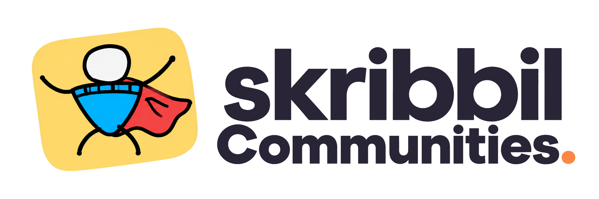
</picture>

### Draw terribly. Guess brilliantly.

A drawing game for your crew, with a community to come back to. Create a room,
share an invite, pick a word, and watch your friends guess everything except
the answer.

**[Play Skribbil →](https://skribbil.pages.dev)** ·
[Run locally](#run-locally) · [Screenshots](#the-new-ui) ·
[Features](#more-than-a-game-room) · [Development](#development-and-verification)

[](https://github.com/Kenshi0905/skribbil/actions/workflows/test.yml)

**Live casual preview · Free hosting · Ranked disabled**

Skribbil runs on the original [scribble.rs](https://github.com/scribble-rs/scribble.rs)
Go engine, with shared accounts, custom avatars, private Clubhouses, friends,
progression, galleries, and league infrastructure around it. **Skribbil is the
only playable game today.** The free backend may take about a minute to wake
after inactivity.

## The new UI

Blue doodle backgrounds, white panels, chunky cartoon headings, purple accents,
and a coordinated charcoal dark theme. The drawing stays at the center, with
player scores on the left and chat on the right on desktop.

<picture>
  <source media="(prefers-color-scheme: dark)" srcset="docs/media/game-guesser-dark.jpg">
  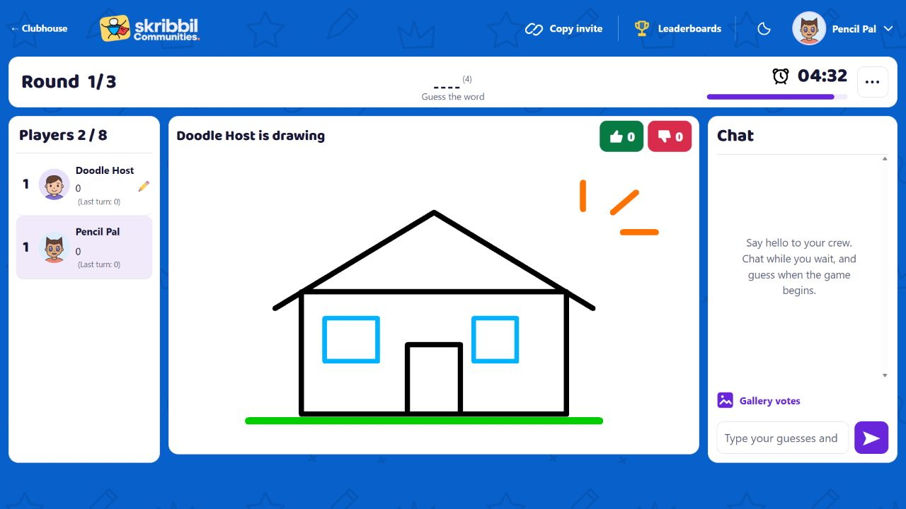
</picture>

*Current game screenshots captured from the running local app on 19 October
2026, using disposable test accounts and real engine connections. The drawings
are demonstration artwork; the screenshots are not design mockups or production
matches. [Media notes and full-size images](docs/media/README.md).*

| During a game | What you see |
| --- | --- |
| **Drawing** | Your private word, the complete canvas, pencil/fill/eraser, the original 26-color palette, four brush sizes, undo, clear, and keyboard shortcuts. |
| **Guessing** | The masked word and existing hints, timer, chat input, and green/red icon-and-count reactions outside the artwork. |
| **Watching** | The live room and chat, with spectator restrictions preserved. |
| **Between turns** | A brief automatic “The word was…” reveal, followed by the next artist choosing a word. No Continue button; sound respects mute and volume settings. |
| **After the match** | Final standings and results. The host’s **Play again** waits for saving, then brings everyone to the same waiting room. |

<details>
<summary>See the drawer’s tools in light and dark mode</summary>

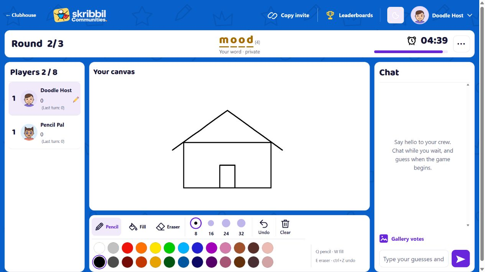

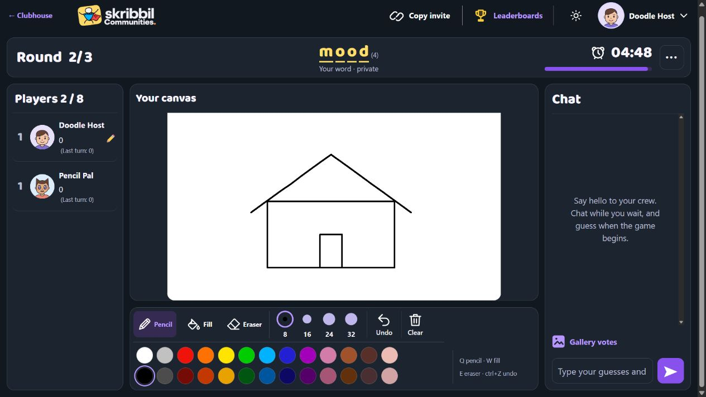

</details>

### Mobile: canvas and typing first

The full canvas keeps its original proportions. **Chat / Players / Gallery
votes** sit below it, and the drawer’s palette stays open while drawing. A
compact header keeps Back, Copy invite, and the room menu within reach.

<p align="center">
  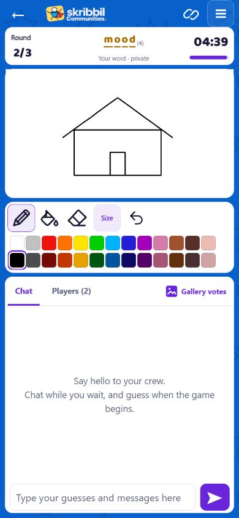
  &nbsp;
  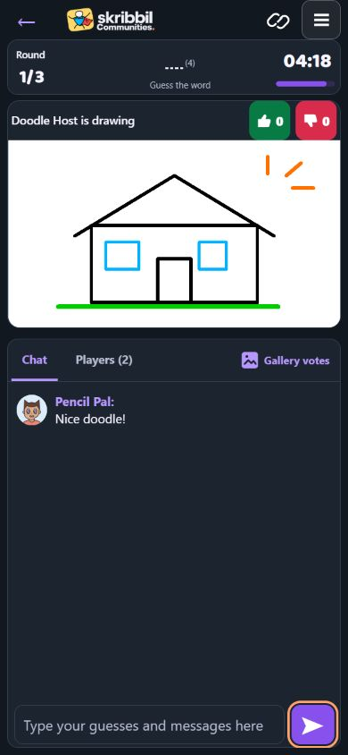
</p>

When typing in a short mobile viewport, the toolbar and secondary chat history
compact away. Round, time, hint, complete artwork, tabs, and the guess field stay
visible. The on-page Send button keeps input focus and supports an explicit tap
during keyboard composition; the normal layout returns after typing.

<p align="center">
  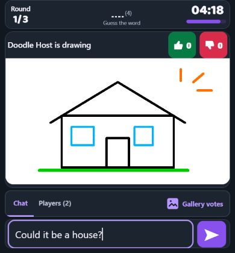
</p>

*This is a reduced browser viewport reserving keyboard space, without a fake
keyboard or browser chrome. Physical Android/iOS keyboard and stylus checks
remain necessary. [Interaction checks and measured latency](docs/mobile-interaction-fixes-2026-10-19.md).*

### Get the room ready

Copy an invitation, see who is ready, edit the room settings, and try a temporary
room look before starting. Guests ready up; the host starts once eligible.
**Play again returns everyone here**, carrying room identities into a fresh
session with zero scores. It never starts the next match automatically.

<picture>
  <source media="(prefers-color-scheme: dark)" srcset="docs/media/waiting-room-dark.jpg">
  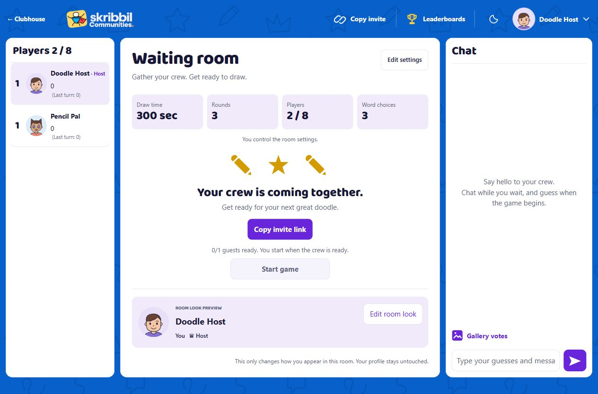
</picture>

<details>
<summary>Room settings and the room-look editor</summary>

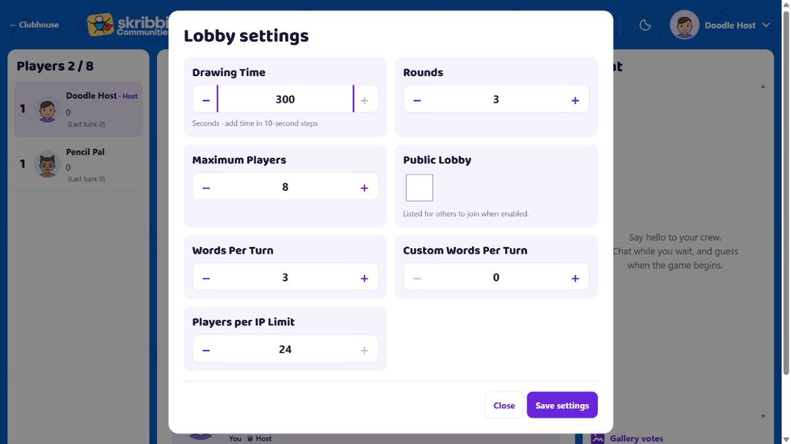

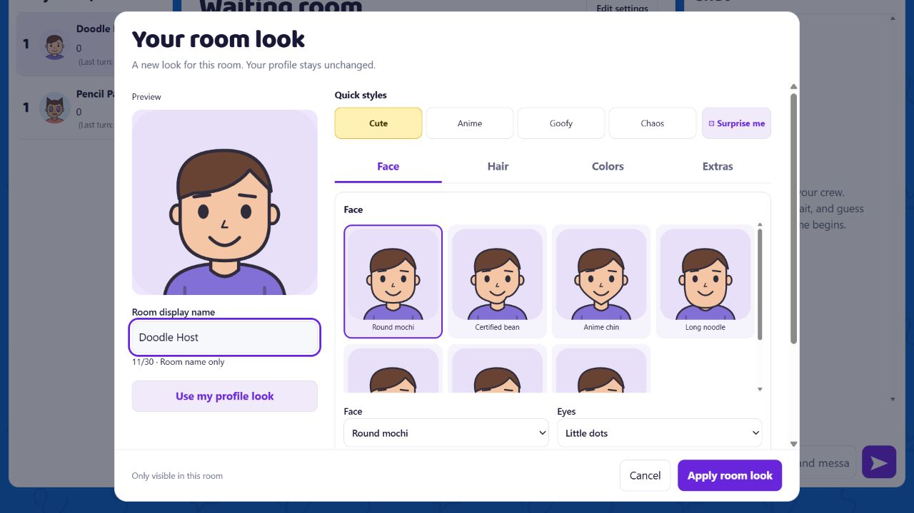

</details>

The **Character Workshop** saves your permanent profile avatar. **Edit room
look** changes only your identity in that room: live preview, display name,
Face/Hair/Colors/Extras, Cute/Anime/Goofy/Chaos styles, **Surprise me**, and
**Use my profile look**. Apply confirms the draft; Cancel discards it. The
existing flat SVG artwork and uploaded-photo support are shared across profile
menus, player lists, chat, leaderboards, and previews.

## More than a game room

<picture>
  <source media="(prefers-color-scheme: dark)" srcset="docs/media/clean-community-dark.jpg">
  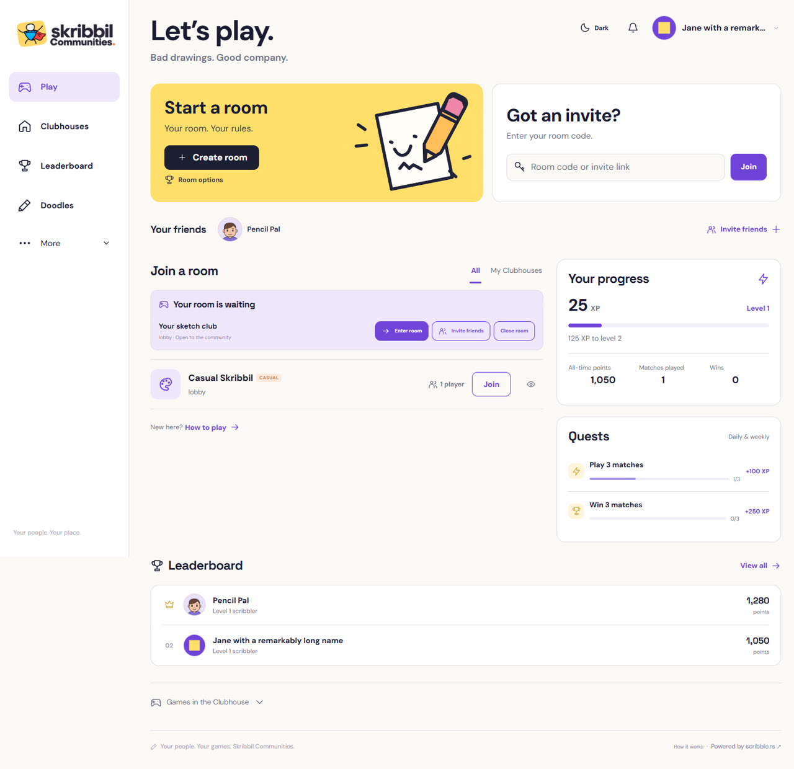
</picture>

*Community-home capture from 15 October 2026 using local test activity. New
communities start with empty progress and standings.*

| Feature | What’s included |
| --- | --- |
| **Profiles and identity** | Character Workshop, cropped PNG/JPEG/WebP photos, account settings, match history, XP, challenges, achievements, trophies, and admin-assigned titles/frames. |
| **Play together** | Configurable private rooms, invites, spectators, friends, parties, readiness, host controls, and shared rematches. |
| **Clubhouses** | Invite-only friend groups created or approved by a platform admin. Members can start, join, and watch their private rooms; links still require membership. |
| **Clans / teams** | Captains, tags, logos, rosters, and recipient-bound invitations, separate from Clubhouses. |
| **Leagues and tournaments** | Seasons, individual/team registration, brackets, historical results, all-time records, disputes, and audited score corrections. Tournament fixture results are currently entered by an admin. |
| **Art and gallery votes** | Automatic drawing archives, separate gallery nominations, artist-controlled publication consent, curated Halls of Fame/Shame, MVP votes, and summary cards. |
| **Sound and themes** | Saved light/dark preference, volume, mute, word-choice effects, and an end-turn sound including the final turn. |

Replay downloads contain final canonical drawing operations, rather than timed
stroke-by-stroke playback. See [feature status](docs/feature-status.md) for the
full implementation and limitation table.

<details>
<summary>See a private Clubhouse and the earlier engine demo</summary>


[Earlier gameplay video](https://github.com/Kenshi0905/skribbil/raw/refs/heads/main/docs/media/gameplay.mp4)
· [Animated preview](docs/media/gameplay.gif). These edited local captures are
from 12 October 2026 and predate the redesigned game UI shown above.

</details>

### The unanimous dislike penalty

Each eligible player can dislike a drawing once. When **every player in the
turn’s frozen voting group** votes, the artist immediately loses exactly
**100 points**, once, and faces a harder word on their next drawing turn.
The artist and spectators do not vote; disconnecting never lowers the threshold.
All offered choices and the timeout choice use the hard pool, and the platform
carries pending account-bound penalties across matches.
[Rules and delivery limits](docs/engine-integration.md).

## Run locally

Requires **Node.js 22+** (24 recommended), **npm**, and **Go 1.25+**.
No hosted account or API key is needed.

**macOS / Linux**

```sh
npm ci
mkdir -p .tools
cd engine
go build -o ../.tools/skribbil-engine ./cmd/scribblers
cd ..
npm run dev
```

**Windows PowerShell**

```powershell
npm ci
New-Item -ItemType Directory -Force .tools
Set-Location engine
go build -o ../.tools/skribbil-engine.exe ./cmd/scribblers
Set-Location ..
npm run dev
```

Open [localhost:3000](http://localhost:3000), register, and create a private room.
Open the invite in a separate browser profile/device for a second account.
Guests ready up in the waiting room, then the host starts.

The launcher starts both services. `PORT` and `ENGINE_PORT` change their defaults,
3000 and 4181. `npm start` runs only the platform; set `ENGINE_URL` if Go runs
separately. Embedded PostgreSQL persists in `.data/postgres`, private artwork in
`.data/assets`, and generated development secrets inside `.data/`. These paths
are Git-ignored; accounts and results use the database.

### Account settings and local administration

Use the account menu → **Account settings** to edit your profile or change your
password. Password changes verify the current password, sign out other sessions,
and keep this browser signed in with a fresh session. Login/registration use a
browser-session cookie by default; **Remember me on this device** requests the
normal seven-day persistent session. Session tokens use HttpOnly cookies.

Photo uploads stay local until **Crop and save**. Pan, zoom, reset, or cancel;
accepted PNG/JPEG/WebP files are limited to 8 MiB and 25 megapixels. The server
validates and re-encodes the cropped image. Permanent titles are assigned through
audited administrator controls.

To grant your registered account **local** admin access, stop the dev server first:

```sh
npm run admin -- YOUR_REGISTERED_USERNAME
npm run dev
```

The embedded database allows one process at a time. Admins approve Clubhouse
requests, manage competitions, review disputes, curate consented artwork, and
record audited corrections.

## Development and verification

The plain JavaScript/CSS frontend uses shared design tokens and reusable
components. Node handles accounts, membership, progression, artwork, and results.
The pinned Go engine owns drawing, guesses, timers, scoring, and concurrent
rooms. The gateway streams WebSockets without rewriting game packets;
authenticated results enter transactional receipts and ledgers that prevent
duplicate awards.

```sh
npm test
npm run check
npm run check:secrets
node --test infra/tests/*.test.mjs
node tests/playtest-10.mjs
node tests/playtest-10.mjs --room-sessions
cd engine
go test -race ./...
```

Build the local engine first as above. The protocol playtests default to
`.tools/skribbil-engine.exe`; on macOS/Linux, run
`export ENGINE_BINARY=.tools/skribbil-engine` before either playtest. Set
`ENGINE_BINARY` for any other binary path. Go’s race detector needs a supported
C toolchain. On Windows, use suitable 64-bit GCC and `CGO_ENABLED=1`; CI runs
race checks on Ubuntu.

Verification covers ten real WebSocket players plus a spectator, drawing/input
regressions, both themes, narrow browser layouts, on-page Send taps in short
viewports, automatic answer reveals, and a two-game rematch flow. The rematch
test deliberately delays result saving, then checks everyone returns to an
unstarted room, can edit their look, and needs guest readiness plus explicit
host Start. Local latency measurements are workstation/loopback results, not
physical-phone or internet performance guarantees.

Configuration is in [.env.example](.env.example). Keep real passwords, tokens,
personal data, and private assets out of Git. Enable the commit/push guards with
`git config core.hooksPath .githooks`; the secret check supplements manual review.

### Hosting and current limits

[Cloudflare Pages](https://skribbil.pages.dev) serves the website;
[Render](https://skribbil.onrender.com) runs Node and Go together in Singapore;
Supabase provides PostgreSQL and private artwork storage. The free preview
deploys the tested server revision before the website, after the platform,
engine, multiplayer, and container CI jobs pass on `main`.

Free hosting can sleep, restart, or reach its quotas. Live Go rooms are in
memory and do not survive a process restart; container replacement can also lose
the local outbox. **Ranked remains disabled.** Production load/recovery and
physical Android/iOS keyboard, touch, and stylus validation remain outstanding.
Production requires external PostgreSQL and private object storage.

Unpublished drawings expire within **24 hours** of match completion and
canonical replay data within **one hour**. Gallery votes add no image copies.
Public artwork requires artist consent and admin selection; active curation
and legal holds affect retention.

| Read next | Details |
| --- | --- |
| [Architecture](docs/architecture.md) · [Data model](docs/data-model.md) · [Schema](database/schema.sql) | Service boundaries, accounts, communities, leagues, and storage. |
| [Feature status](docs/feature-status.md) · [Verification](docs/verification.md) | Implemented behavior, test evidence, and launch limits. |
| [Mobile interactions](docs/mobile-interaction-fixes-2026-10-19.md) · [Rematch flow](docs/rematch-waiting-room-2026-10-19.md) | Send/input, drawing latency measurements, and return-to-waiting behavior. |
| [Engine integration](docs/engine-integration.md) · [Gallery voting](docs/gallery-voting.md) | Preserved game rules, authenticated results, votes, and retention. |
| [Live deployment](docs/free-deployment.md) · [Changelog](CHANGELOG.md) | Hosting configuration and implementation history. |
| [Screenshot notes](docs/media/README.md) | Capture dates, themes, viewport sizes, and earlier demo media. |

## Credits and license

Skribbil builds on [scribble.rs](https://github.com/scribble-rs/scribble.rs).
The original engine and required license notices are retained. The platform is
[BSD-3-Clause licensed](LICENSE); see [third-party notices](THIRD_PARTY_NOTICES.md)
and the [pinned upstream revision](engine/UPSTREAM.md).

This is an independent community project. The name **Skribbil** and new community
artwork do not remove or replace upstream license obligations.
